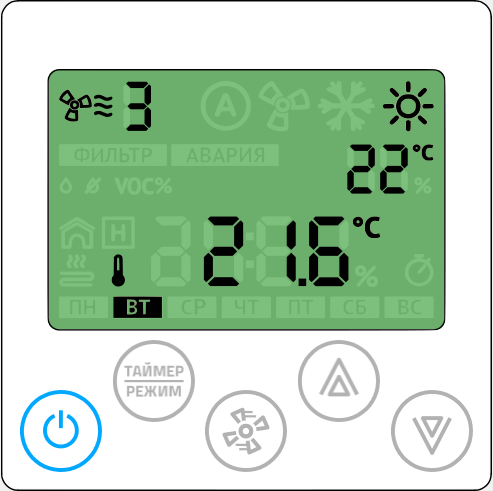

# Панель управления климатом Zentec Z031-2C0 — интеграция с LightHub

> Документ описывает настенную панель управления климатом **Z031-2C0** с
> нестандартной прошивкой **P190919LH** (адаптация стокового ПО P190919 под
> LightHub), её карту регистров Modbus и схему интеграции в умный дом
> LightHub + Home Assistant. Все примеры в документе — обобщённые рабочие
> конфигурации; имена топиков соответствуют схеме `house/<контроллер>/...`.
>
> Назначение переработанного ПО: с одной панели в помещении управлять
> кондиционером, приточной вентиляцией, увлажнителем, температурой воздуха
> (батареи отопления) и температурой тёплого пола.

---

## 1. Отличия от стоковой прошивки

Стоковая панель Z031 управляла одной вентустановкой и имела дежурный режим.
В прошивке P190919LH пользовательский интерфейс переработан:

| Функция | Стоковая прошивка | P190919LH |
|---|---|---|
| Кнопка «Питание» | Дежурный/рабочий режим | Вкл/выкл кондиционера (гл. экран); вкл/выкл увлажнителя (режим увлажнения); смена режима кондиционера (режим кондиционера) |
| Главный экран | Рабочий экран вентустановки | Попеременно: уставка температуры воздуха и текущее время |
| Стрелки ↑/↓ (гл. экран) | — | Уставка температуры воздуха: применяется одновременно к термостату батарей **и** к кондиционеру |
| Кнопка «Вентилятор» | Скорость вентустановки | Интенсивность многозональной приточной вентиляции (значок «A» — авторежим по датчику CO2) |
| Кнопка «Режим» | — | Циклическое переключение экранов: главный → увлажнение → качество воздуха → уличная температура → тёплый пол → кондиционер |
| Режим «температура отработанного теплоносителя» | Отображение | Заменён на **настройку температуры тёплого пола** |
| Режим «отображение и обработка воздуха» | Режим вентустановки | Заменён на **режим управления кондиционером** (уставка — стрелки, режим — «Питание», скорость вентилятора — «Вентилятор») |

Режимы дежурного/рабочего в новом ПО нет. При работе кондиционера его режим
индицируется вверху панели значками «охлаждение» / «нагрев» / «вентиляция».
Мигание значка «волнистая линия» у индикатора скорости вентиляции означает,
что вентилятор включён (даже если он обслуживает иную зону).

## 2. Органы управления и индикации



| Поз. | Назначение | Описание |
|---|---|---|
| 1 | Индикатор работы вентилятора |  В главном режиме — установленная скорость приточной вентиляции или авторежим. Мигает, когда работает приточная вентиляция в доме |
| 2 | «Фильтр» / «Авария» |  Требуется замена фильтра / серьёзная авария |
| 3 | Дополнительный режим |  /  режим увлажнения;  режим качества воздуха |
| 4 | Физические параметры |  встроенный датчик,  канальный,  улица,  помещение,  тёплый пол (с настройкой),  мощность нагревателя, % |
| 5 | День недели | |
| 6 | Режим кондиционера |  авто,  вентиляция,  охлаждение,  нагрев |
| 7 | Вспомогательный индикатор |  уставка температуры;  уставка влажности/качества воздуха;  сервисный режим параметризации |
| 8 | Главный индикатор |  время,  код ошибки,  температура,  влажность/качество воздуха |
| 9 | Индикатор таймера |  выполняется управление по расписанию |
| 10.1 | «Питание» | Главный экран — вкл/выкл кондиционера; увлажнение — вкл/выкл увлажнителя; кондиционер — смена режимов работы |
| 10.2 | «Таймер/Режим» | Циклическое переключение экранов: главный → увлажнение → качество воздуха → уличная температура → тёплый пол → кондиционер; настройка времени/даты в сервисных меню |
| 10.3 | «Вентилятор» | Главный экран — скорость приточной вентиляции; кондиционер — скорость вентилятора кондиционера; вход в меню параметризации (удержание 4 с) |
| 10.4/10.5 | «Стрелка вверх/вниз» | Изменение уставок и параметров, вход в дополнительные меню |

## 3. Меню параметризации

Вход: удержание кнопки «Вентилятор» 4 секунды, выбор пункта стрелками,
вход — кратковременное нажатие «Вентилятор».

| № | Пункт | Назначение |
|---|---|---|
| 1 | `o_1` | Настройка расписания (таймер, задачи t1–t9) |
| 2 | `o_2` | Настройка часов и календаря |
| 3 | `o_3` | Настройка параметров (группы A, B, C, D, E, F, U) |

Кнопки в меню: «Режим» — переход между полями (в о\_1 — активация записи
таймера), «Питание» — выход в главный экран, «Вентилятор» — переход к
следующему полю (в о\_3 — кольцевой переход группа → номер → значение).

## 4. Карта регистров Modbus

Протокол: Modbus RTU, `8E1` (8 бит, чётность Even, 1 стоп-бит), 9600 бод.
Тип регистра параметров: беззнаковый 2 байта, команда чтения
Read Holding Registers.

### 4.1 Группа A — технологические параметры (адреса 50000–50007)

| Параметр | Назначение | Нач. значение | Доступ | Адрес |
|---|---|---:|:---:|---:|
| A0 | Маска режима тёплого пола (аналог A6) | 10 | R/W | 50000 |
| A1 | Маска режима кондиционера (аналог A6) | 15 | R/W | 50001 |
| A2 | Конфигурация вентилятора кондиционера (аналог A5) | 3 | R/W | 50002 |
| A3 | Кол-во скоростей кондиционера | 3 | R/W | 50003 |
| A4 | Макс. кол-во скоростей вентилятора (1–7). При 0 — не выводится скорость, авторежим, знак вентилятора и обдува | 5 | R/W | 50004 |
| A5 | Конфигурация вентилятора: bit0 — разрешить авторежим; bit1 — значок вентилятора; bit2 — значок обдува | 5 | R/W | 50005 |
| A6 | Маска режима работы: bit0 — vent, bit1 — warm, bit2 — cool, bit3 — auto | 15 | R/W | 50006 |
| A7 | Маска дополнительных режимов: bit0 — влажность; bit1 — качество воздуха; bit2 — тёплый пол; bit3 — кондиционер | 15 | R/W | 50007 |

### 4.2 Группа B — технологические параметры (адреса 50008–50015)

| Параметр | Назначение | Нач. значение | Доступ | Адрес |
|---|---|---:|:---:|---:|
| B0 | Мин. уставка температуры (15–30) | 15 | R/W | 50008 |
| B1 | Макс. уставка температуры (30–255) | 35 | R/W | 50009 |
| B2 | Мин. уставка влажности (0–50) | 25 | R/W | 50010 |
| B3 | Макс. уставка влажности (50–100) | 70 | R/W | 50011 |
| B4 | Мин. уставка качества воздуха (0–50) | 10 | R/W | 50012 |
| B5 | Макс. уставка качества воздуха (50–100) | 99 | R/W | 50013 |
| B6 | Точка измерения температуры (вывод на гл. экран): 0 — встроенный датчик; 1 — канальный; 2 — вытяжка (домик) | 1 | R/W | 50014 |
| B7 | Маска вспомогательного вывода: bit0 — встроенная T; bit1 — канальная T; bit2 — вытяжка; bit3 — улица; bit4 — тёплый пол; bit5 — мощность нагревателя % | 24 | R/W | 50015 |

### 4.3 Группы C, D, E, F — параметры свободного назначения

Адреса 50016–50047 (C0–C7, D0–D7, E0–E7, F0–F7), по 8 ячеек в группе,
значения 0–255, R/W, начальное значение 0.

### 4.4 Группа U — системные параметры (адреса 50048–50055)

| Параметр | Назначение | Нач. значение | Доступ | Адрес |
|---|---|---:|:---:|---:|
| U0 | Флаг первого включения | 0 | R/W | 50048 |
| U1 | Корректировка встроенного датчика T (шаг 1 °C) | 10 | R/W | 50049 |
| U2 | Время автовыхода из вспомогательных меню, с (5–30) | 15 | R/W | 50050 |
| U3–U6 | Подсветка min/max дневная и ночная (0–100) | 20/100/0/20 | R/W | 50051–50054 |
| U7 | Резерв | 0 | R/W | 50055 |

### 4.5 Переменные управления (адреса 39993–40008)

| Назначение | ПЗУ | Пределы | Нач. значение | Доступ | Адрес |
|---|:---:|---|---:|:---:|---:|
| Авторежим вентилятора | — | 0/1 | — | R/W | 39999 |
| Авторежим вентилятора конд. | — | 0/1 | — | R/W | 39993 |
| Уставка скорости вентилятора (приток) | + | 1–7 | 1 | R/W | 40000 |
| Главный режим работы (битовая маска) | + | 1/2/4/8 | 1 | R/W | 40001 |
| Главная уставка температуры | + | 0–99 | 18 | R/W | 40002 |
| Главный пуск (питание кондиционера) | + | 0–1 | 0 | R/W | 40003 |
| Аварии 01–16 | — | битовая маска | — | R/W | 40004 |
| Аварии 17–32 | — | битовая маска | — | R/W | 40005 |
| Аварии 33–48 | — | битовая маска | — | R/W | 40006 |
| Главная уставка влажности | + | 0–99 | 0 | R/W | 40007 |
| Главная уставка VOC % | + | 0–99 | 0 | R/W | 40008 |
| Уставка температуры кондиционера | — | °C | — | R/W | 39994 |
| Режим работы тёплого пола | — | | — | R/W | 39995 |
| Уставка температуры тёплого пола | — | °C | 30 | R/W | 39996 |
| Скорость вентиляции кондиционера | — | | 0 | R/W | 39997 |
| Увлажнение включено | — | 0/1 | 0 | R/W | 39998 |

Битовая маска главного режима (40001): bit0 — vent (1), bit1 — warm (2),
bit2 — cool (4), bit3 — auto (8).

**ВАЖНО.** Регистры 40000, 40001, 40002, 40007, 40008 имеют прямой доступ к
ПЗУ (flash с ресурсом 10000 циклов записи). Частая запись недопустима.
Запись значения вне диапазона, ограниченного параметрами групп A/B, приводит
к циклической перезаписи ПЗУ и преждевременному выходу панели из строя.
Поэтому в LightHub для таких параметров включён `prefetch: true` —
контроллер пишет в регистр только при реальном изменении значения.

### 4.6 Аварии

Регистры 40004/40005/40006 — битовые маски аварий E01–E16, E17–E32,
E33–E48 (бит 0 = E01 и т.д.). Запись значения 1–15 блокирует клавиатуру,
останавливает систему («Главный пуск» = 0) и показывает «АВАРИЯ Exx».
Запись 0 возвращает экран в главный режим. Можно записывать несколько бит
одновременно — сообщения выводятся последовательно. В конфигурации Эдема
регистр 40005 (alm17) используется для отображения аварии увлажнителя,
40004 (alm01) — аварии вентустановки.

При отсутствии запросов к панели на экране выводится код «АВАРИЯ LN».

### 4.7 Технические переменные (только чтение, 30000–30002)

| Назначение | Тип | Доступ | Адрес |
|---|---|:---:|---:|
| Температура от встроенного датчика* | SInt16 | R | 30000 |
| Влажность от встроенного датчика** | UInt8 | R | 30001 |
| Встроенный датчик качества воздуха** | UInt8 | R | 30002 |

### 4.8 Технические переменные (R/W, 40009–40017)

| Назначение | Тип | Доступ | Адрес |
|---|---|:---:|---:|
| Канальный внешний датчик температуры (приточный воздух)* | SInt16 | R/W | 40009 |
| Температура наружного воздуха* | SInt16 | R/W | 40010 |
| Температура вытяжного воздуха* | SInt16 | R/W | 40011 |
| Температура тёплого пола* | SInt16 | R/W | 40012 |
| Канальный датчик влажности*** | UInt8 | R/W | 40013 |
| Общая мощность нагревателя, %*** | UInt8 | R/W | 40014 |
| Качество воздуха с внешнего датчика | UInt16 | R/W | 40015 |
| Текущая температура кондиционера* | SInt16 | R/W | 40016 |
| Скорость главной вентустановки | UInt8 | R/W | 40017 |

\* значение ×10 (267 → 26.7 °C). \*\* в модели Z031-2C0 не используется.
\*\*\* значение 0–99.

Часы/календарь панели также доступны по Modbus: 65512 — год, 65513 — месяц,
65514 — день, 65515 — день недели, 65516 — час, 65517 — минута, 65518 —
секунда, 65519 — часовой пояс (UInt8, R/W).

## 5. Интеграция с LightHub

Панель — Modbus RTU-абонент контроллера LightHub (тип канала **MBUS**,
канал-тип 14). Архитектура интеграции на примере объекта «Эдем»:

```
                       MQTT (Home Assistant, syslog)
                              ▲        │
                              │        ▼
                     ┌─────────────────────┐
                     │  LightHub "house3"   │  CAN addr 13
                     │  - Modbus master    │──── RTU 8E1 9600 ──► Панель Z031 №1 (зал)      addr 31
                     │  - PID термостаты   │──── RTU 8E1 9600 ──► Панель Z031 №2 (кабинет)  addr 32
                     │  (батареи, тёплый   │──── RTU 8E1 9600 ──► Панель Z031 №3 (спальня)  addr 33
                     │   пол)              │──── 1-Wire ──► датчики температуры помещений/полов
                     │  - датчики CO2 (S8) │
                     └─────────┬───────────┘
                               │ CAN (маршрутизация команд/статусов)
                               ▼
                     ┌─────────────────────┐
                     │  LightHub "air"     │  CAN addr 15
                     │  - приточная        │──── Modbus ──► вентустановка (приток, нагреватели, насос)
                     │    вентустановка    │
                     │  - MULTIVENT: зоны  │──── реле задвижек зон
                     │  - HUMIDIFIER:      │──── клапаны зон, насос, датчик давления
                     │    увлажнение       │
                     │  - PID по CO2       │───── CO2 датчики Sensair S8 по комнатам
                     └─────────────────────┘
```

### 5.1 Modbus-шаблон панели

Шаблон `panel` задаётся в секции `modbus` конфига LightHub. Он описывает
линию (`serial: "8E1"`), расписание опроса (`poll`) и таблицу соответствия
параметров (`par`). Опрашиваются диапазоны 39993–40008 и 30000–30001
каждые 5 секунд:

```json
"panel": {
  "serial": "8E1",
  "poll": {
    "regs": [[39993, 40008], [30000, 30001]],
    "delay": 5000
  },
  "par": { ... }
}
```

Каждый параметр `par` привязывает имя (subitem) к регистру и опциям:

| Имя (subitem) | Регистр | Опции | Смысл |
|---|---:|---|---|
| `fanspeed` | 40000 | `prefetch`, `map`, `id: 7` (S\_FAN) | Скорость приточной вентиляции; `map.val` [1,255,1,5] масштабирует 1–7 в 0–255; команда OFF → 0 |
| `settemp` | 40002 | `prefetch`, `id: 12` | Уставка температуры воздуха (батареи + кондиционер) |
| `alm01` / `alm17` / `alm33` | 40004/40005/40006 | `id: 13/14/15` | Регистры аварий |
| `sethum` | 40007 | `prefetch`, `id: 16` | Уставка влажности |
| `setvoc` | 40008 | `prefetch`, `map.val` [400,2000,0,100], `id: 17` | Уставка качества воздуха: ppm CO2 ↔ % |
| `roomtemp` | 30000 | `type: "x10"` | Температура встроенного датчика (×10) |
| `hum` | 30001 | | Влажность встроенного датчика |
| `voc` | 30002 | | Качество воздуха встроенного датчика |
| `ch_temp` | 40009 | `type: "x10"` | Приточный (канальный) воздух |
| `ext_temp` | 40010 | `type: "x10"`, `id: 18` | Наружная температура |
| `out_temp` | 40011 | `type: "x10"`, `id: 19` | Температура вытяжки |
| `floor_temp` | 40012 | `type: "x10"`, `id: 20` | Температура тёплого пола |
| `ch_hum` | 40013 | `id: 28` | Влажность канального датчика |
| `heat_pwr` | 40014 | `id: 29` | Мощность нагревателя, % |
| `extvoc` | 40015 | `map.val` [400,2000,0,100], `id: 27` | CO2 внешнего датчика (ppm ↔ %) |
| `actemp` | 40016 | `type: "x10"`, `id: 25` | Текущая температура кондиционера |
| `fanlvl` | 40017 | `id: 21` | Скорость главной вентустановки |
| `floormode` | 39995 | `prefetch`, `id: 22` | Режим тёплого пола |
| `setfloor` | 39996 | `prefetch`, `id: 23` | Уставка тёплого пола |
| `humpwr` | 39998 | `prefetch`, `map.cmd` ON→1 / OFF→0, `id: 24` | Увлажнение вкл/выкл |
| `fanauto` | 39999 | `prefetch`, `map.cmd` ENABLE/AUTO→1, DISABLE→0, `id: 7` | Авторежим вентиляции по CO2 |
| `acsettemp` | 39994 | `prefetch`, `id: 26` | Уставка кондиционера |
| `acon` | 40003 | `prefetch`, `map.cmd` OFF→0, `def: 40001`, `id: 8` | Питание кондиционера |
| `acmode` | 40001 | `prefetch`, `map.cmd` FAN\_ONLY→1, HEAT→4, COOL→2, AUTO→8, `id: 8` | Режим кондиционера |
| `acfanauto` | 39993 | `prefetch`, `map.cmd` AUTO→1, `def: 39997`, `id: 2` | Авторежим вентилятора кондиционера |
| `acfan` | 39997 | `prefetch`, `map.cmd` OFF→0, LOW→1, MEDIUM→2, HIGH→3, `id: 2` | Скорость вентилятора кондиционера |
| `y/mo/d/dw/h/m/s` | 65512–65518 | | Часы/календарь |
| `blmind/blmaxd/blminn/blmaxn` | 50051–50054 | | Подсветка |

Механика драйвера MBUS:

- **Опрос**: списки `regs` читаются каждые `delay` мс; найденные значения
  публикуются в статусные топики (или направляются в связанные items через
  `item`/`emit` у параметра).
- **Запись**: при получении команды на item ищется параметр шаблона по имени
  subitem, иначе — по числовому коду суффикса, совпадающему с `id`
  (стандартные коды: S\_CMD=1, S\_SET=2, S\_VAL=3, S\_FAN=7, S\_MODE=8).
- **`prefetch: true`**: перед записью читается текущее значение регистра;
  запись выполняется только при отличии. Обязательно для регистров с
  прямым доступом к ПЗУ (см. раздел 4.5).
- **`map.val`** масштабирует числовое значение между регистром и
  LightHub-значением: `[fromRegMin, fromRegMax, toMin, toMax]`.
  **`map.cmd`** преобразует текстовые команды (ON, HEAT, COOL...) в числа
  регистра и обратно. **`def`** — подстановка значения из другого регистра
  при записи.
- **`@S: 0`** в описании параметра item'а подавляет повторную публикацию
  неизменившегося статуса.

### 5.2 Каналы панелей (items)

Каждая панель — item типа `MBUS` (14) с адресом абонента и именем шаблона:

```json
"p_zal3": [14, [31, "panel", { ...маршрутизация параметров... }], null, 8192, 0]
```

Первый элемент — Modbus-адрес панели (31/32/33), второй — имя шаблона,
третий — объект маршрутизации. Маршрутизация связывает параметр шаблона с
локальными items, MQTT и CAN:

```json
"p_zal3": [14, [31, "panel", {
  "fanspeed":  { "can": [15, 3, "fan", 7], "@S": 0 },
  "settemp":   [{ "item": "tzal3/set", "@S": 0 },      // уставка → PID батарей
                { "item": "ac_zal3/set" }],            // и → уставка кондиционера
  "acsettemp": { "item": "ac_zal3/set", "@S": 0 },
  "acon":      { "item": "ac_zal3/cmd", "@S": 0 },
  "acfanauto": { "item": "ac_zal3/fan", "@S": 0 },
  "setfloor":  { "item": "tfl31/set", "@S": 0 },       // уставка тёплого пола → PID пола
  "sethum":    { "can": [15, 431, "set"], "@S": 0 },   // → увлажнитель на контроллере air
  "humpwr":    { "can": [15, 431, "cmd"], "@S": 0 },
  "setvoc":    { "can": [15, 331, "set"], "@S": 0 },   // → CO2-PID вентиляции на air
  "fanauto":   { "can": [15, 331, "cmd"], "@S": 0 },
  "hum":       { "emit": "${snsr}humzal3/val", "@S": null,
                 "can": [15, 431, "val"] },            // влажность → air (обратная связь)
  "roomtemp":  { "emit": "t_zal3_p", "@S": 0 },
  "ch_temp": {}, "ext_temp": {}, "out_temp": {}, "extvoc": {},
  "floor_temp": {}, "actemp": {}, "fanlvl": {},
  "alm01": {}, "alm17": {}, "alm33": {},
  "acmode": { "@S": 0 }, "acfan": { "@S": 0 },
  "m": {}, "s": {}, "blmind": {}, "blmaxd": {}
}], null, 8192, 0]
```

Элемент `"can"` — маршрутизация на другой контроллер по CAN: `[адрес,
itemId, суффикс, subitem]`. Здесь `15` — CAN-адрес контроллера `air`,
`331/332/333` — item'ы PID-регуляторов CO2 (`co2zal3`, `co2cab3`,
`co2bedr3`), `431/432/433` — item'ы PID-регуляторов увлажнения
(`humzal3`, `humcab3`, `humbedr3`). Элемент `"emit"` публикует значение в
MQTT-топик, `"item"` отправляет в локальный item.

### 5.3 Управление температурой воздуха (батареи + кондиционер)

Уставка с панели (`settemp`, регистр 40002) расходится на два контура:

- **PID-термостат батарей** (`tzal3`, `tcab3`, `tbedr3` — тип 13): уставка
  через `"item": "tzal3/set"`, вход — 1-Wire датчик температуры помещения
  (`p_zal3/ch_temp` → `tzal3`), выход — slow-PWM реле термоклапана
  (`rzal3` — тип 16, RELAYPWM).
- **Кондиционер** (`ac_zal3`, `ac_cab3` — тип 10, ACHAIER): уставка
  `ac_zal3/set` берётся из `acsettemp` панели, а `settemp` одновременно
  обновляет её — стрелки на главном экране меняют температуру и батарей,
  и кондиционера.

Текущая температура кондиционера (`actemp`, регистр 40016) передаётся в
`ac_zal3/temp` и дальше в Home Assistant как `current_temperature`.

### 5.4 Управление тёплым полом

Режим тёплого пола на панели (регистры 39995/39996) связан с локальными
PID-регуляторами пола: `setfloor` → `tfl31/set` (туалет), `tfl32/set`
(ванна), `tbath3/set` (ванная при спальне). Температура пола приходит
обратно в регистр 40012 через 1-Wire датчики (`p_zal3/floor_temp` ←
`tfl31` и т.д.).

### 5.5 Вентиляция и увлажнение (контроллер air)

Приточная вентиляция и увлажнение живут на отдельном контроллере `air`
(CAN-адрес 15), панель ими управляет через CAN-маршрутизацию (см. 5.2):

- **Приточная вентиляция** — item `vents` (тип 18, MULTIVENT): зоны
  `zal3`, `cab3`, `bedr3` с задвижками; центральная установка `vent`
  (тип 14, MBUS, шаблон `airset`) — приточный вентилятор, нагреватели,
  насос. Запросы воздуха в зоны формируют PID-регуляторы CO2
  (`co2zal3` и т.д., тип 13, вход — датчик Sensair S8, выход — `/fan`
  зоны). Панель через `fanspeed` (S\_FAN, CAN item 3 — центральная
  установка) и `setvoc`/`fanauto` (CAN item 331/332/333 — CO2-PID зоны)
  задаёт интенсивность и режим «авто по CO2». Статус скорости главной
  установки возвращается в панель через регистр 40017 (`fanlvl`).
- **Увлажнение** — item `hum` (тип 21, HUMIDIFIER) на контроллере `air`:
  насос, промывочный клапан, зональные клапаны, датчик давления. Панель
  управляет зоной (`humpwr` → вкл/выкл увлажнителя зоны, `sethum` →
  уставка) через CAN item'ы `humzal3`/`humcab3`/`humbedr3` (PID, тип 13),
  влажность помещения передаётся панелью обратно на `air` и в MQTT
  (`${snsr}humzal3/val`). Авария увлажнителя подаётся на панели через
  регистр 40005 (`alm17`).

### 5.6 Home Assistant (MQTT)

Статусные топики LightHub (`house/s_out/...`) и командные топики
(`house/house3/...`, `house/air/...`) подключаются к HA через
`mqtt.yaml`. Примеры сущностей, связанных с панелями:

```yaml
# Кондиционер зала (панель p_zal3, item ac_zal3)
climate:
  - name: "Кондиционер Зал 3"
    modes: [off, heat, auto, cool, fan_only]
    fan_modes: [auto, high, medium, low]
    mode_state_topic: "house/s_out/ac_zal3/cmd"
    mode_command_topic: "house/house3/ac_zal3/cmd"
    temperature_low_command_topic: "house/house3/ac_zal3/set"
    temperature_high_command_topic: "house/house3/tzal3/set"   # уставка батарей
    current_temperature_topic: "house/s_out/ac_zal3/temp"     # actemp (reg 40016)
    fan_mode_command_topic: "house/house3/ac_zal3/fan"

# Увлажнитель зала (контроллер air)
humidifier:
  - name: "Увлажнитель зал 3-й этаж"
    command_topic: "house/air/humzal3/cmd"
    state_topic: "house/s_out/humzal3/cmd"
    target_humidity_command_topic: "house/air/humzal3/set"
    target_humidity_state_topic: "house/s_out/humzal3/set"
    current_humidity_topic: "house/snsr/humzal3/val"

# Приток зала (multivent + CO2-PID, preset auto/manual)
fan:
  - name: "Приток зал 3эт"
    state_topic: "house/s_out/vents/zal3/cmd"
    command_topic: "house/air/vents/zal3/cmd"
    percentage_state_topic: "house/s_out/vents/zal3/fan"
    percentage_command_topic: "house/air/vents/zal3/fan"
    preset_mode_state_topic: "house/s_out/co2zal3/ctrl"
    preset_mode_command_topic: "house/air/co2zal3/ctrl"

# Климат (батареи, PID термостат)
  - name: "Климат Зал"
    mode_command_topic: "house/house3/tzal3/cmd"
    temperature_command_topic: "house/house3/tzal3/set"
    current_temperature_topic: "house/s_out/t_zal3"
    action_topic: "house/s_out/rzal3/action"

# Тёплый пол
  - name: "Теплый пол туалет"
    mode_command_topic: "house/house3/tfl31/cmd"
    temperature_command_topic: "house/house3/tfl31/set"
    current_temperature_topic: "house/s_out/t_fl31"

# Аварии на панелях
sensor:
  - name: "Увлажнитель авария"
    state_topic: "house/in/panels/alm17/set"
  - name: "Вентиляция авария"
    state_topic: "house/in/panels/alm01/set"
  - name: "Вентилятор"            # скорость главной вентустановки (reg 40017)
    state_topic: "house/in/panels/fanlvl/set"
    unit_of_measurement: '%'
```

Групповой item `panels` (`[7, 210]`, члены `p_zal3`, `p_cab3`,
`p_bedr3`) даёт единые топики `house/in/panels/<параметр>/set` для
широковещательного управления всеми панелями сразу (используется для `alm01`,
`alm17`, `fanlvl`).

## 6. Замечания по эксплуатации

- Панель синхронизирует время по Modbus (регистры 65512–65518) — при
  подключении к LightHub время ведёт контроллер.
- Не пишите в ПЗУ-регистры (40000/40001/40002/40007/40008) чаще, чем это
  делает человек с панели; `prefetch: true` в шаблоне защищает от
  избыточных записей.
- Уставка VOC задаётся в LightHub в ppm CO2 (400–2000) и масштабируется в
  проценты панели (0–100 %; 50 % ≈ 1000 ppm).
- Код «АВАРИЯ LN» на панели означает отсутствие Modbus-запросов —
  проверяйте линию и контроллер.

---

**Источник данных**: документ «Стандартное программное обеспечение панели
P190919 LH, адаптированное под систему умного дома LightHub» (D190919LH),
драйверы `lighthub/modules/out_modbus.*`
(CH\_MBUS), `out_multivent.*` (CH\_MULTIVENT), `out_humidifier.*`
(CH\_HUMIDIFIER), `out_ac.*` (CH\_AC), `out_pid.*` (CH\_PID).
